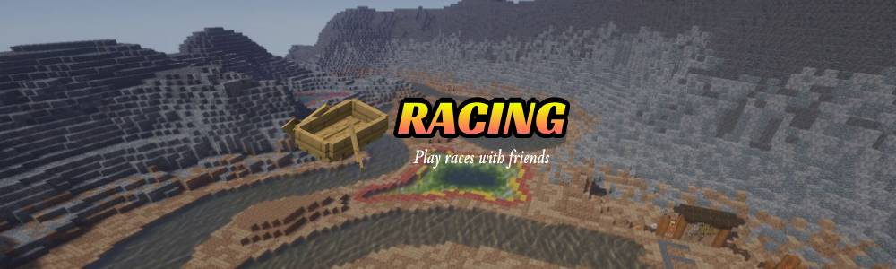

# Racing - Spigot Plugin 4.6.0-SNAPSHOT

Create and play race with your friends.

Supported race type (Boat, Elytra, Horse, Minecart, Pig, Strider, Walk)

Created in Minecraft Version : 1.16.0
Tested in Minecraft Version : 1.16.0 to 1.21.4

Available languages (English, French, Slovak, Swedish)

# Dependencies

## Requirements

- Protocolib ^5.x (Required for plugin work)

### (Optional)

- DecentHolograms ^2.x (For hologram display) (Recommended)
- NoteBlockAPI ^1.x (For play custom song from note block)
- McEconomy + Vault (For economy support)

## Acknowledgment

- Creator: Hornata
- Maintainer: ORN_Fox (From 4.3.0)
- Contributors:
  - ulysse-mercadal (Particles debuging and migration to DecentHolograms)
  - Syl2010 (Helping pom creation for compilation)
